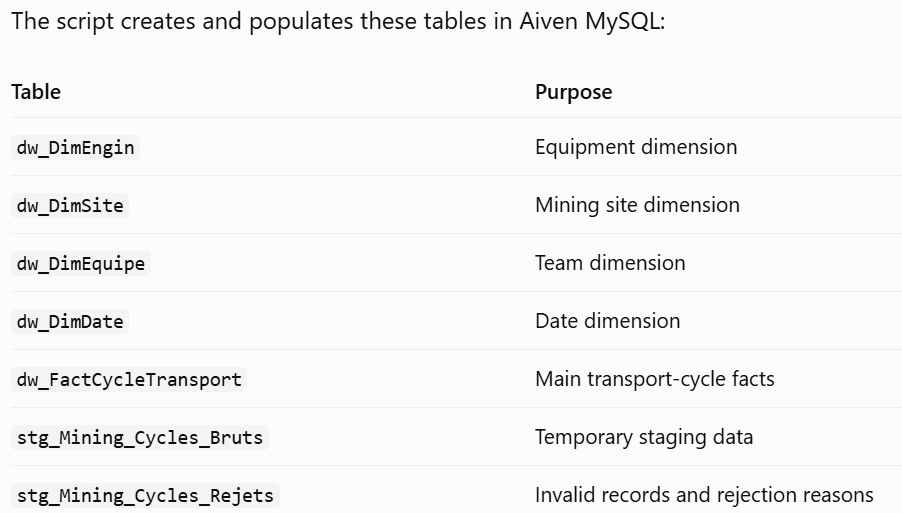
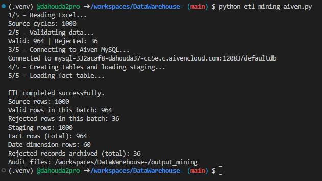

# DataWarehouse-

## 1. Domaine Mining
La solution couvre toute la chaîne décisionnelle, depuis les données brutes des cycles de transport minier jusqu’à l’entrepôt de données, aux requêtes SQL et aux KPI de pilotage.
### SGBD : SQL Server
- Les quatre dimensions — date, engin, site et équipe — ainsi que la table de faits FactCycleTransport. 
- La dimension DimSite sera utilisée deux fois dans les analyses : pour le site de chargement et pour le site de déchargement.

* The Python script implements an ETL pipeline for mining transport-cycle data, using an Excel workbook as the source and Aiven MySQL as the target data warehouse.

## 2. ETL workflow
### 2.1. Input data
The Excel workbook contains four sheets:
- Mining_Engins: equipment information.
- Mining_Sites: mining site details.
- Mining_Equipes: team and shift information.
- Mining_Cycles_Bruts: transport-cycle records, payload, duration, and number of trips.

### 2.2 Target database
The script creates and populates these tables in Aiven MySQL:

#### Results

### 2.3 Important technical features
- Uses SQLAlchemy and PyMySQL to connect to Aiven MySQL.
- Reads database credentials and configuration from environment variables.
- Supports secure TLS connections.
- Validates data before loading it into the warehouse.
- Uses INSERT IGNORE to help prevent duplicate dimension and fact records.
- Stores rejected records for troubleshooting.
- Uses staging tables to separate raw data from warehouse data.